# `build-apk.cmd` 一键发包脚本说明

日期：2026-11-06。对应源码：`ba1f9a8` + F92 的产物命名改动（脚本自身的完整链路在改动前后一致，改动只影响产物名与最新件探测）。

本文描述 `android/bin/build-apk.cmd` 的**实际行为**：它做什么、按什么顺序探测、把什么交给谁、失败时会怎样、产物落在哪里、依赖哪些文件。所有内容都来自逐行读源码与本轮真实跑通的结果，不做推测；末节列出仍未验证的部分。

---

## 1. 定位与职责边界

这个脚本是**本机 Android arm64 开发测试包的双击入口**，不是构建系统的一部分。它只做三件事：探测工具链、调用标准构建入口、报告与可选安装。

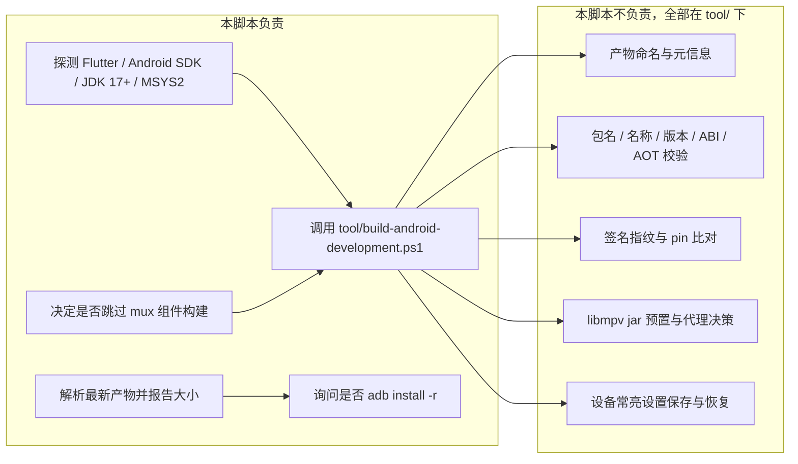

三条硬边界：

- **不重复任何规则**。签名、身份、版本、ABI、AOT 的判定只存在于 `tool/*.ps1`，脚本里没有任何一份副本，因此不会出现两处规则漂移。
- **不碰正式包**。开发测试身份由 Gradle 属性 `bilisailDevelopmentBuild=true` 打开（[android/app/build.gradle.kts:85](../../android/app/build.gradle.kts)：`applicationIdSuffix = ".test"`、标签「BiliSail 测试版」）；CI 与正式发布走 `tool/build-release.ps1`，不传该属性，也不经过本脚本。
- **不做破坏性动作**。安装只用 `adb install -r`；不卸载、不 `pm clear`、不强制降级；junction 清理只用 `rmdir`（删链接，不删目录内容）。

---

## 2. 全链路主流程

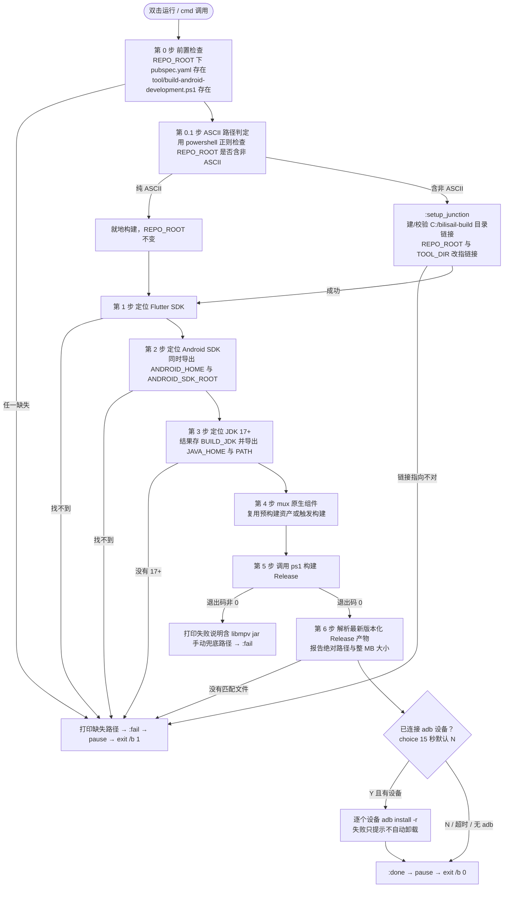

流程图对应源码里的六个 `echo [n/6]` 计数点与三个子过程（`:find_on_path`、`:setup_junction`、`:java_major`）；`:fail` 与 `:done` 是两个终点，唯一区别是退出码 1 还是 0。

---

## 3. 逐个步骤的真实逻辑

### 3.1 第 0 / 0.1 步：前置检查与非 ASCII 路径绕行

判定用 `powershell -NoProfile -Command`，而不是 `pwsh`——注释写明原因：某些环境下 cmd 的 `for /f` 解析不了 `pwsh` 的应用执行别名。判据是正则 `[^\u0000-\u007F]`。

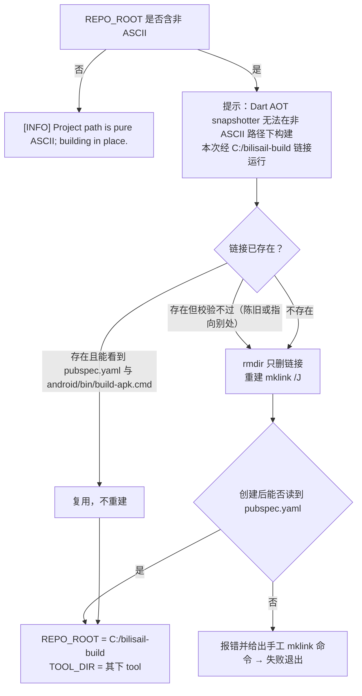

要点：链接只是别名，不复制文件、不额外占盘；脚本每次都会校验它指向的是本工程；`build-apk.cmd` 自身必须留在 `android/bin/` 下（第 0 步就是靠 `..\..\` 反推仓库根）。

### 3.2 第 1~3 步：工具链探测顺序

顺序即优先级，先命中先用；三条探测链互不依赖但都在构建前完成。

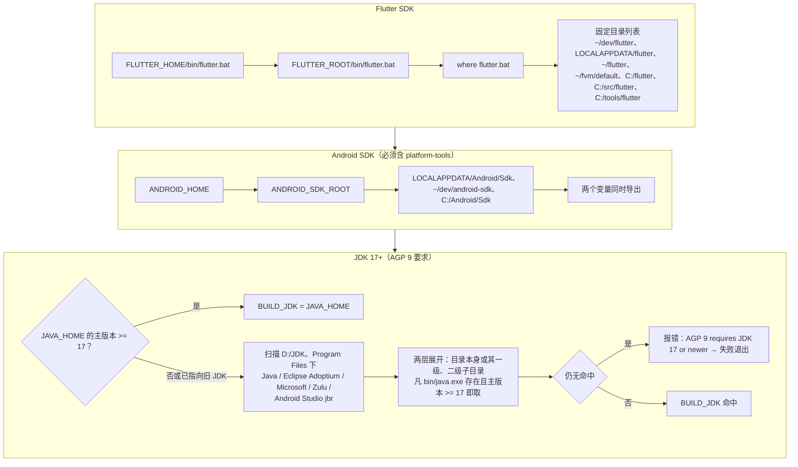

`java_major` 用 `java -version` 的第 3 个 token 取主版本号，取不到记 0（即视为不合格）。JDK 找到后在**第 4 步开头**才导出：

```
set "JAVA_HOME=%BUILD_JDK%"
set "PATH=%BUILD_JDK%\bin;%PATH%"
set "FLUTTER_SUPPRESS_ANALYTICS=true"
```

这一步正是本轮实测的关键：本机 `JAVA_HOME` 指向 Dragonwell 8，直接调 ps1 会让 Gradle 报「configured to use JVM 8」；脚本自己探测到 `D:\JDK\…dragonwell-21…` 并覆盖后，Gradle 正常跑完。日志行形如 `[3/6] JDK : D:\JDK\…\dragonwell-21.0.12.0.12+8-GA (Java 21)`。

### 3.3 第 4 步：mux 原生组件复用或构建

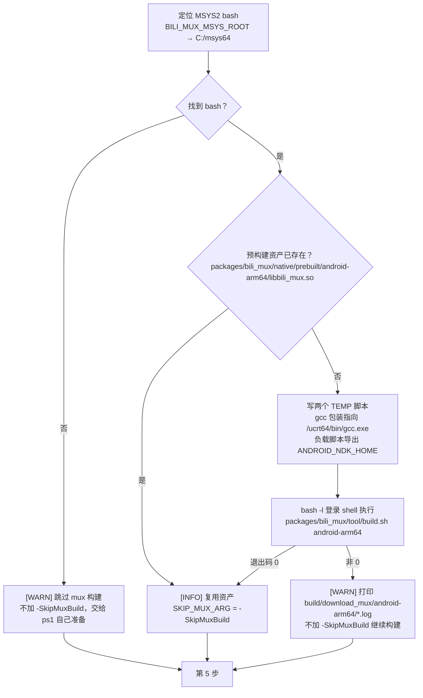

两处刻意为之的细节：**必须用 `bash -l`**（非登录 shell 不会把 `/usr/bin` 放进 PATH，gcc 会静默失败）；**NDK 固定 `28.2.13676358`**，由 `tool/build-download-mux.ps1` 校验 `source.properties`，本脚本只在 TEMP 负载里导出同一路径。若既没有 MSYS2 又没有预构建资产，ps1 会在准备 mux 时抛错——这是如实的失败路径，不是「自动降级成功」。

### 3.4 第 5 步：交给 ps1

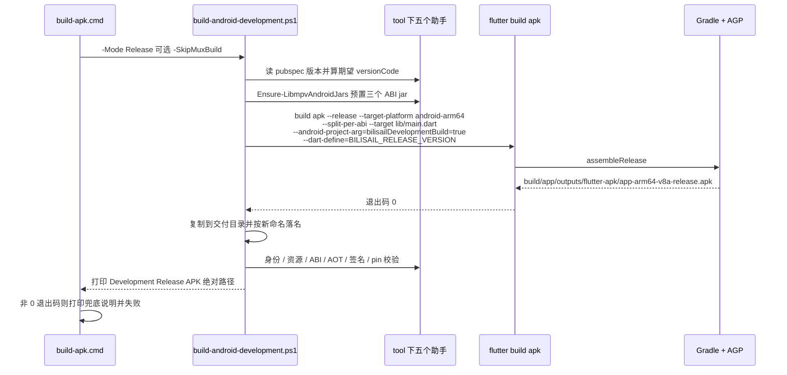

脚本只判断 `$LASTEXITCODE`，不解释 ps1 内部逻辑，因此 ps1 的任何新校验都不需要同步改本脚本。承载方式是 `where pwsh` 优先、退回 `where powershell`，两者都没有才报「Neither pwsh nor powershell was found on PATH」；调用固定带 `-NoProfile -ExecutionPolicy Bypass`，避免用户 profile 与执行策略影响构建。

### 3.5 第 6 步：产物解析与报告

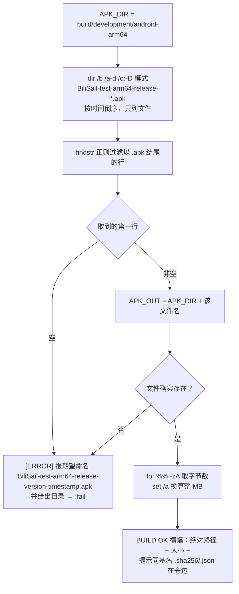

`findstr` 这一步不是多余：`dir` 的旧式通配会把 `*.apk.sha256` 这类相邻 sidecar 一起带出来，靠 `\.` + `apk$` 锚定结尾才排除；同时旧固定名 `BiliSail-test-arm64-release.apk` 不匹配新 glob，因此不会被当成交付件。这三点都做过夹具验证，见第 7 节。

### 3.6 收尾：可选安装

只在 `%SDK%\platform-tools\adb.exe` 存在时进入；`choice /t 15 /d N` 意味着**不按键就是跳过安装**；设备列表来自 `adb devices | findstr /r /c:"device$"`，逐台 `adb install -r`。安装失败只提示「插 USB + 打开 USB 调试后重试」，不卸载、不清数据。最后 `:done` / `:fail` 都以 `pause` 结束，让双击窗口不闪退。

---

## 4. 依赖文件与代码架构

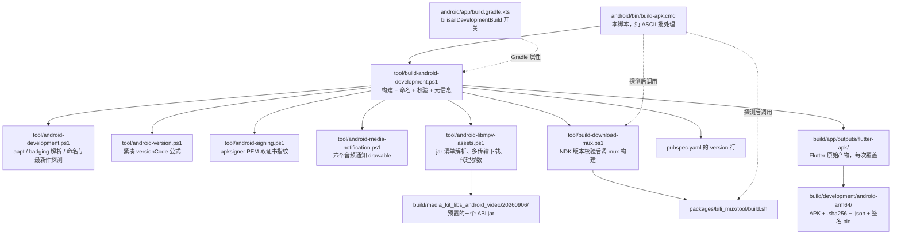

各依赖被本脚本使用的具体点：

| 文件 | 谁调用 | 用途 |
| --- | --- | --- |
| [tool/build-android-development.ps1](../../tool/build-android-development.ps1) | 本脚本第 5 步（唯一入口） | 构建、命名、复制、校验、写元信息、可选安装 |
| [tool/android-development.ps1](../../tool/android-development.ps1) | ps1 点源；三个设备回归脚本也点源 | `Get-AndroidDevelopmentApkName`、`Resolve-AndroidDevelopmentApk`、aapt 定位与 UTF-8 安全读取、badging 解析与拒绝规则 |
| [tool/android-version.ps1](../../tool/android-version.ps1) | ps1 | `major*10000 + minor*1000 + patch*100 + build` 紧凑 versionCode，格式不符即抛 |
| [tool/android-signing.ps1](../../tool/android-signing.ps1) | ps1 | `apksigner verify --print-certs-pem` 取唯一证书的 SHA-256 |
| [tool/android-media-notification.ps1](../../tool/android-media-notification.ps1) | ps1 | `aapt dump resources` 校验六个音频通知 drawable 未被 shrink 掉 |
| [tool/android-libmpv-assets.ps1](../../tool/android-libmpv-assets.ps1) | ps1 | Gradle 评估期会下载的三个 libmpv jar 先按插件自身 pin 预置，必要时才透传系统代理 |
| [tool/build-download-mux.ps1](../../tool/build-download-mux.ps1) | ps1（第 4 步未加 `-SkipMuxBuild` 时） | 校验 NDK 修订号后经 MSYS2 构建 `libbili_mux.so` |
| [android/app/build.gradle.kts](../../android/app/build.gradle.kts) | Gradle | `bilisailDevelopmentBuild=true` 时切 `.test` 包名与「BiliSail 测试版」标签 |
| [pubspec.yaml](../../pubspec.yaml) | ps1 | 版本与构建号来源，同时决定产物名里的版本段与期望 versionCode |

架构上只有两层是「规则拥有者」：ps1 及其助手（构建语义）、`android/app/build.gradle.kts`（身份语义）。本脚本属于第三层——环境适配层，换机器时只需要它能找到自己的工具链。

---

## 5. 产物、命名与元信息

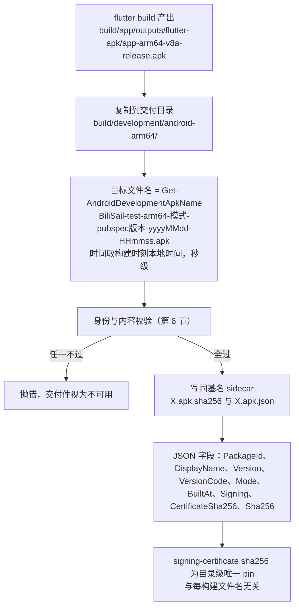

本轮真实产物（F92 之后第一次全链路）：

```
build\development\android-arm64\
  BiliSail-test-arm64-release-6.2.6+6-20261106-100544.apk        63,743,588 字节
  BiliSail-test-arm64-release-6.2.6+6-20261106-100544.apk.sha256
  BiliSail-test-arm64-release-6.2.6+6-20261106-100544.apk.json   BuiltAt 2026-11-06T10:05:44+08:00
  signing-certificate.sha256
```

与 Flutter 原始输出的关系：`build/app/outputs/flutter-apk` 那一格是中间物（名字固定、每次覆盖）；交付目录里的是**已经过校验**的那一份。旧固定名 `BiliSail-test-arm64-release.apk` 已不再产出，需要「当前普通入口包」的脚本改用 `Resolve-AndroidDevelopmentApk` 按模式取最新件。

---

## 6. ps1 侧的校验流水线（脚本产物为什么可信）

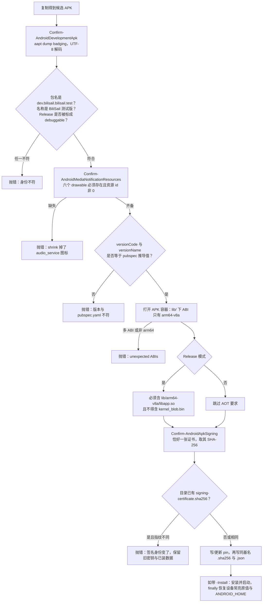

顺序按 [tool/build-android-development.ps1:60](../../tool/build-android-development.ps1) 起的实际代码排列：身份 → 通知资源 → 版本 → ABI → AOT → 签名 → pin → 元信息。

本脚本不复制以上任何一条判据，只是把它们的结果转述给用户；因此 ps1 增加校验时，本脚本无需改动即可保持「通过才报 BUILD OK」。

---

## 7. libmpv jar 与代理决策（Gradle 评估期的网络兜底）

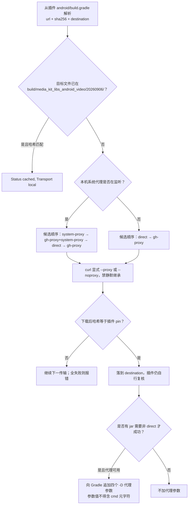

两条不变式：pin 只从插件自己的 `build.gradle` 解析，脚本内不复制常量；无论走哪条传输，插件在 Gradle 阶段仍会自己校验哈希——本兜底**不放松任何完整性检查**。

---

## 8. 失败面与退出码

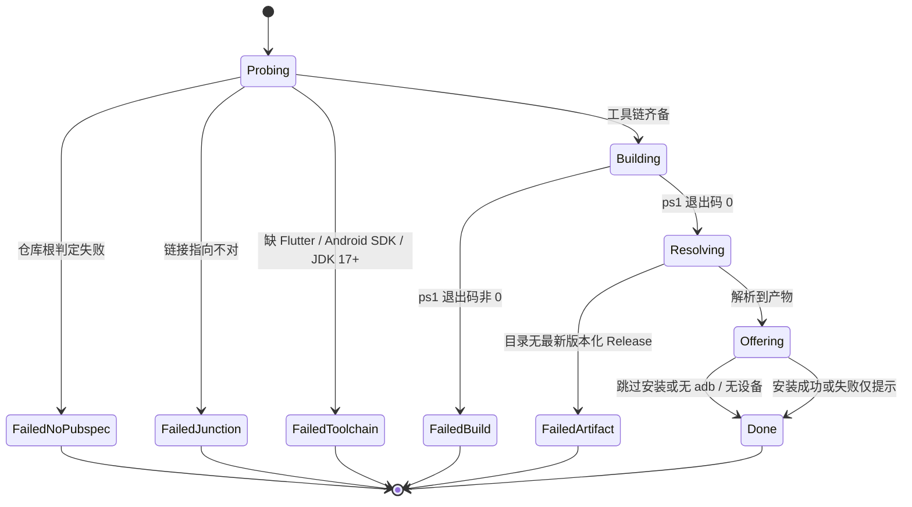

| 失败态 | 用户看到什么 | 恢复动作 |
| --- | --- | --- |
| 缺 `pubspec.yaml` | 提示脚本必须留在 `android/bin/` | 把脚本放回原位，不要在别处调用 |
| junction 校验不过 | 打印手工命令 `mklink /J C:/bilisail-build <repo>` | 按提示建链接，或把工程移到纯 ASCII 路径 |
| 找不到 JDK 17+ | 「AGP 9 requires JDK 17 or newer」 | 装 JDK 17+，或把它放进被扫描的固定目录 |
| 无 MSYS2 且无 mux 资产 | 只有 WARN，随后 ps1 报缺原生资产 | 装 MSYS2，或按 mux README 预置 `libbili_mux.so` |
| Gradle 构建失败 | 退出码 + libmpv jar 手动兜底路径 | 按提示手工放置三个 jar 后重跑（哈希仍会校验） |
| 没有匹配产物 | 期望命名格式 + 目录 | 说明 ps1 未产出交付件，看 ps1 日志而非本脚本 |
| 安装失败 | 提示接 USB 与开调试后重试 | 不自动卸载、不清数据，保持已装版本与数据 |

退出码只可能是 `0`（`:done`）或 `1`（`:fail`）。注意：把本脚本或 ps1 的输出接进管道（例如 `| tail`）会让上层看到的退出码变成管道程序的退出码，**掩盖真实失败**；需要判成败时直接取 `$LASTEXITCODE` / `errorlevel`。

---

## 9. 运行方式

```
:: 双击 android\bin\build-apk.cmd（推荐，人交互）
:: 或命令行
cmd /c android\bin\build-apk.cmd < NUL      :: 免按键，choice 走默认 N
pwsh -File tool\build-android-development.ps1 -Mode Release -SkipMuxBuild   :: 绕过本脚本，需自备 JDK 17+ 环境
```

本脚本无参数：模式固定 Release、目标固定 `lib/main.dart`、ABI 固定 arm64。需要 Debug/Profile 或别的入口时直接用 ps1 并自行处理 JDK；`-Install` 需要显式设备号，本脚本的安装分支不依赖它。

---

## 10. 已核 / 未验证

**已核（本轮真实跑过）**

- 全链路真实成功一次：脚本自行探测到 Dragonwell 21（本机 `JAVA_HOME` 指向 JDK 8），Gradle 通过，产物名 `BiliSail-test-arm64-release-6.2.6+6-20261106-100544.apk`，63,743,588 字节，`BuiltAt 2026-11-06T10:05:44+08:00`，身份 `dev.bilisail.bilisail.test`／「BiliSail 测试版」／VersionCode 62606。
- 第 6 步的解析行是**从本脚本原文抽出**跑夹具验证的：同模式最新件胜出、`.apk.sha256`/`.apk.json` 不被当产物、旧固定名不匹配、Profile 与 Release 互不串、空目录按预期报错。
- `tool/check.ps1 -Stage Lint -SkipPub` 全绿（CI 计划 27、Android 版本 41、签名边界 21、开发包身份 7、媒体通知资源 25；五工程 `dart format` 0 改动；`flutter analyze` 无问题）。
- 交付件 SHA-256 与改名前那次构建逐字相同，说明命名改动只影响文件名、不影响 APK 内容。

**未验证**

- 真人双击场景的交互分支：本轮把 stdin 重定向到 NUL 跑通，日志里 `choice` 直接落在 N、`pause` 未阻塞，但无法区分这是「15 秒超时默认」还是「输入被重定向后的即时默认」；`Y → 安装` 这条路径当时无设备，没有执行过。
- 非 ASCII 路径的 junction 分支：本机工程路径本来就是纯 ASCII，`:setup_junction` 只经代码读过，未实跑。
- mux 组件的「现场构建」分支：本机命中预构建资产，`bash -l` + gcc 包装那条路径本轮没跑。
- libmpv jar 的下载与代理分支：三个 jar 全部命中 `cached via local`，`direct` / `gh-proxy` / `system-proxy` 传输选择与 Gradle `-D` 参数透传未在本机复现。
- Profile / Debug 模式的新命名产物未构建过；三个设备回归脚本解析到的最新件是否被正确安装与恢复，需要连设备验证。
- 上表失败态的文案与行为按源码描述，除「Gradle JVM 版本不符」这一条外，其余未逐条实测触发。
